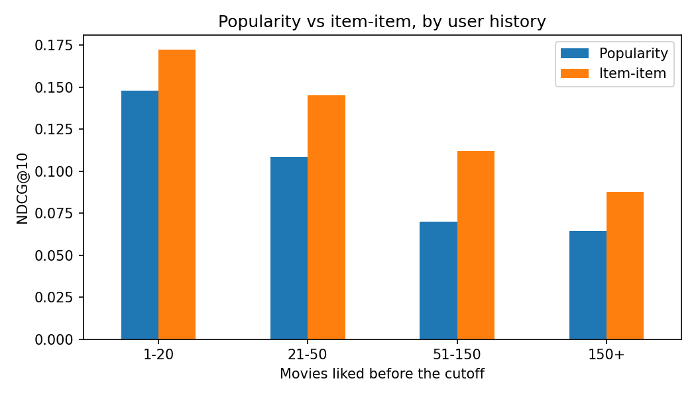

# Movie Recommender

Comparing a one-size-fits-all popularity list against personalized recommendations, evaluated on what users actually went on to like.

**[Live demo](https://movie-recommender-fa.streamlit.app/)** — pick a few movies and see both recommenders side by side.

## The question

Does personalization beat simply recommending what's popular, and by how much? Most recommender tutorials never check, because they don't build the baseline.

## Data

MovieLens 25M: 25 million ratings from 162,000 users, 1995-2019. Users with fewer than 20 ratings and movies with fewer than 50 were removed, leaving 24.6M ratings across 13,176 movies.

A rating of 4 or more counts as **liked**. That's what the models try to surface.

## Why validation is time-based

Models train on ratings before **2018-01-01** and are tested on what users liked after it. A random split would let the model see a user's future ratings while predicting their past ones.

| | Train | Test |
|---|---|---|
| Period | before 2018 | 2018-2019 |
| Ratings | 22,261,221 | 414,622 |
| Users evaluated | | 6,269 |

**Most future activity is cold start.** About 83% of post-cutoff ratings came from users or movies the model had never seen, and were excluded. Collaborative filtering can't recommend for someone it has no history on.

## Models

- **Popularity** — the most-liked movies, the same list for everyone.
- **Item-item collaborative filtering** — "people who liked this also liked that." Each movie is scored by its cosine similarity to what the user already liked.

## Why ranking metrics

A recommender shows a list, so it's judged on the list. Most MovieLens projects report RMSE on predicted star ratings, which measures something no user ever sees.

- **Recall@10** — of the movies the user went on to like, what share made the top 10?
- **Precision@10** — of the 10 shown, how many did they like?
- **NDCG@10** — like recall, but hits near the top count more.

A random recommender scored 0.003 NDCG@10, which confirmed the evaluation code works before any real model was trusted.

## Results

Two separate samples of 1,000 test users:

| | NDCG@10 (sample 1) | NDCG@10 (sample 2) | Precision@10 |
|---|---|---|---|
| Random | 0.003 | | 0.003 |
| Popularity | 0.079 | 0.077 | 0.065 |
| Item-item | **0.111** | **0.115** | **0.098** |

Item-item wins by about 45%, and the gap held across both samples. Roughly 1 in 10 of its recommendations is a movie the user went on to like, against 1 in 15 for popularity.

## Findings

**Popularity gets most of the way there.** It reaches about two-thirds of item-item's score while knowing nothing about the user. Personalization adds the last third.

**Item-item helps mid-history users most.**



| Movies liked before 2018 | Users | Popularity | Item-item | Lift |
|---|---|---|---|---|
| 1-20 | 90 | 0.148 | 0.173 | +16% |
| 21-50 | 115 | 0.109 | 0.145 | +34% |
| 51-150 | 348 | 0.070 | 0.112 | +61% |
| 150+ | 447 | 0.064 | 0.088 | +36% |

The two lighter groups are small, so their numbers are noisier.

**Heavy users are harder to recommend for, for a clear reason.** Both models score lower as history grows. Light users go on to like famous movies: 24% of their next likes were among the 100 most popular. For users with 150+ likes it was 5%. They've already seen the classics, so what they like next is more niche.

## What I'd do differently

- Handle cold start. Most future activity came from new users or movies, which this approach can't serve. Content-based features (genre, year) would help.
- Try matrix factorization as a third model.
- Evaluate every test user rather than samples of 1,000.

## About the demo

The demo uses the 3,000 most-liked movies and each movie's 50 nearest neighbors, pre-computed in notebook 03. This approximates the notebook model closely while keeping the app small enough to host for free.

## Repo layout

```
notebooks/
  01-data-and-split.ipynb    filtering, time-based split, metric check
  02-models.ipynb            popularity and item-item
  03-evaluation.ipynb        results by user history, demo export
src/
  metrics.py                 recall, precision, NDCG, evaluation loop
  recommenders.py            both models, reusable
  download_data.py
app.py                       Streamlit demo
demo/                        movie list and neighbor table for the demo
reports/figures/
data/                        not committed
```

## Setup

Reproduce the analysis:

```bash
pip install -r requirements-dev.txt
python src/download_data.py
jupyter notebook
```

Run the demo locally:

```bash
pip install -r requirements.txt
streamlit run app.py
```

## Licence and data

Code in this repo is MIT licensed. MovieLens 25M is subject to GroupLens' own terms and is not redistributed here. The files in `demo/` contain movie titles and derived similarity scores, not user ratings.

Harper & Konstan (2015), *The MovieLens Datasets: History and Context*, ACM TiiS 5(4).
